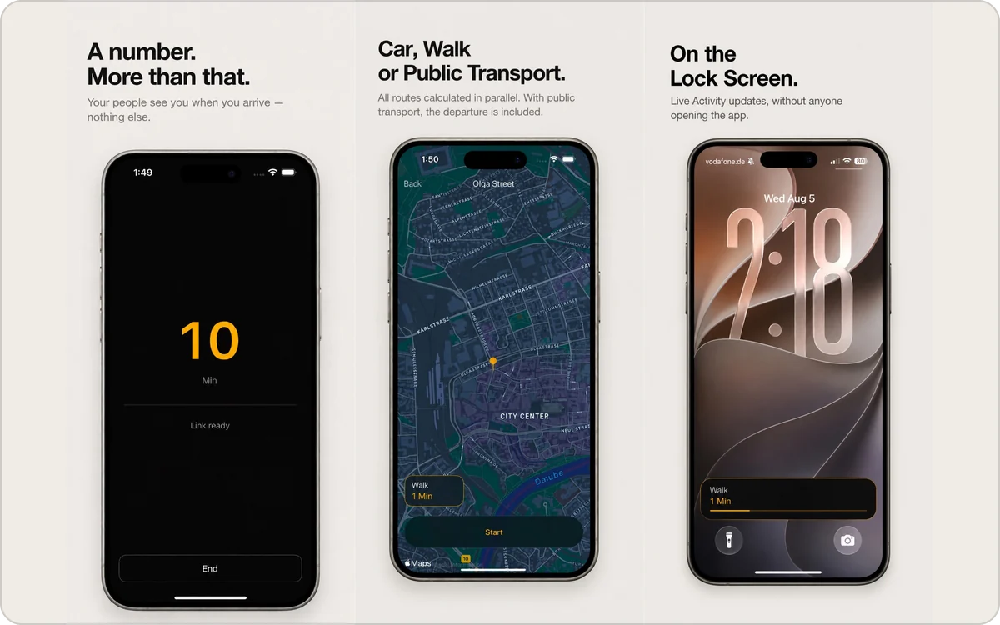
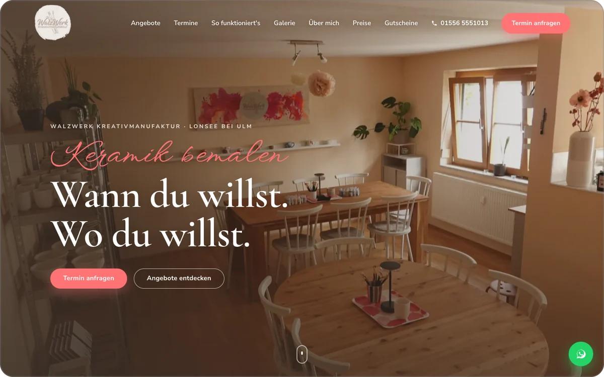
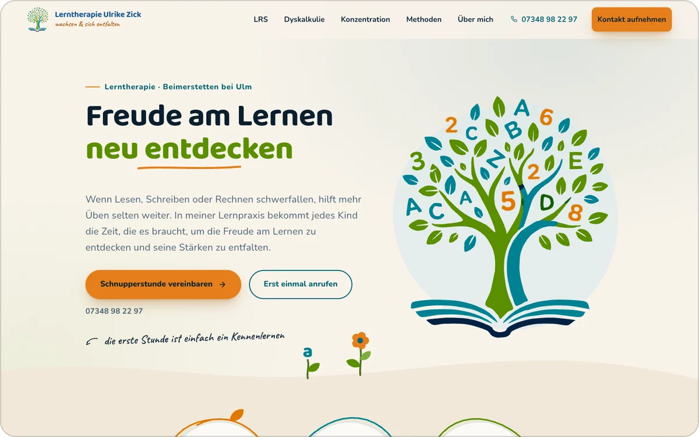

<picture>
  <source media="(prefers-color-scheme: dark)" srcset="assets/banner-dark.svg">
  
</picture>

 

I study computer science at Ulm University and build products for real customers: websites for small businesses with my studio **[clado](https://cladostudio.com)**, an iPhone app on the App Store, and now **[Yando](https://yando-ki.de)**, AI automation for mid-sized companies, together with [@jannisd07](https://github.com/jannisd07).

### Now

- **Building Yando.** Software that reads orders, invoices and enquiries from emails and PDFs and hands them to the ERP as drafts a person approves. [yando-ki.de](https://yando-ki.de)
- **Running clado.** Websites for trades, restaurants and service businesses near Ulm, from the first call to launch and maintenance. [cladostudio.com](https://cladostudio.com)
- **Studying.** B.Sc. Computer Science at Ulm University, after two semesters of Data Science & AI at DHBW Heidenheim, working at WMF.

### Selected work

<table>
  <tr>
    <td width="50%" valign="top">
      
      

        <b><a href="https://cladostudio.com">cladostudio.com</a></b> 
        My studio's own site. A Blender-rendered island that moves in the browser and a three.js configurator running in a Web Worker. No frame over 20&nbsp;ms on a 4×&nbsp;throttled CPU. 
        Astro · Cloudflare Workers · three.js · WebGL · Blender
      

    </td>
    <td width="50%" valign="top">
      
      

        <b><a href="https://apps.apple.com/us/app/arrive-share-your-eta/id6798065612">arrive</a></b> 
        iPhone app that shares only the minutes until you arrive, never your live location. Concept, design and development through to the App Store. 
        iOS · Live Activities · privacy by design
      

    </td>
  </tr>
</table>

<table>
  <tr>
    <td width="50%" valign="top">
      
      

        <b><a href="https://walzwerk-kreativ.de">WalzWerk Kreativmanufaktur</a></b> 
        Website for a ceramics painting studio with its own booking system: online booking and payment, gift vouchers and an admin area for dates. 
        Client project · booking · payments
      

    </td>
    <td width="50%" valign="top">
      
      

        <b><a href="https://www.lernen-zick.de">Lerntherapie Ulrike Zick</a></b> 
        Multi-page site for a learning therapy practice, with a contact form protected against spam without captchas or third-party services. Brand and print design included. 
        Client project · no third-party services
      

    </td>
  </tr>
</table>

Before that, at WMF: process analysis for AI-assisted customer service and a Python prototype that reads emails and attachments, recognises the type of request and extracts the key data.

### Toolbox

`TypeScript` `Python` `Astro` `Cloudflare Workers` `three.js` `WebGL` `Blender` `Flutter` `Dart` `PHP` `Git` `Claude Code`

### Contact

[cladostudio.com](https://cladostudio.com) · [LinkedIn](https://www.linkedin.com/in/dominikklossika/) · [hallo@cladostudio.com](mailto:hallo@cladostudio.com)
